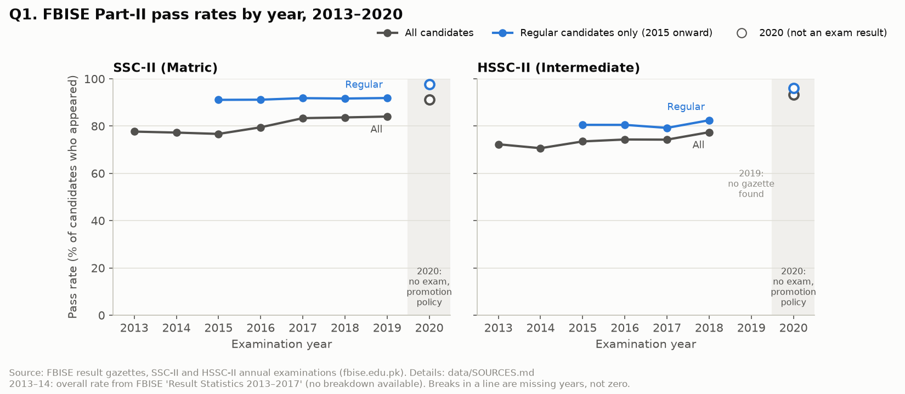
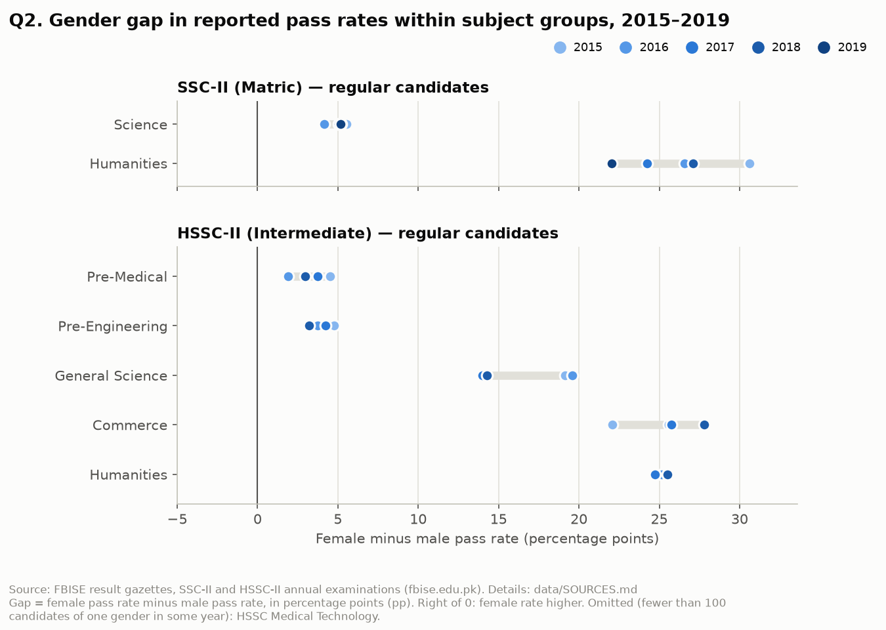
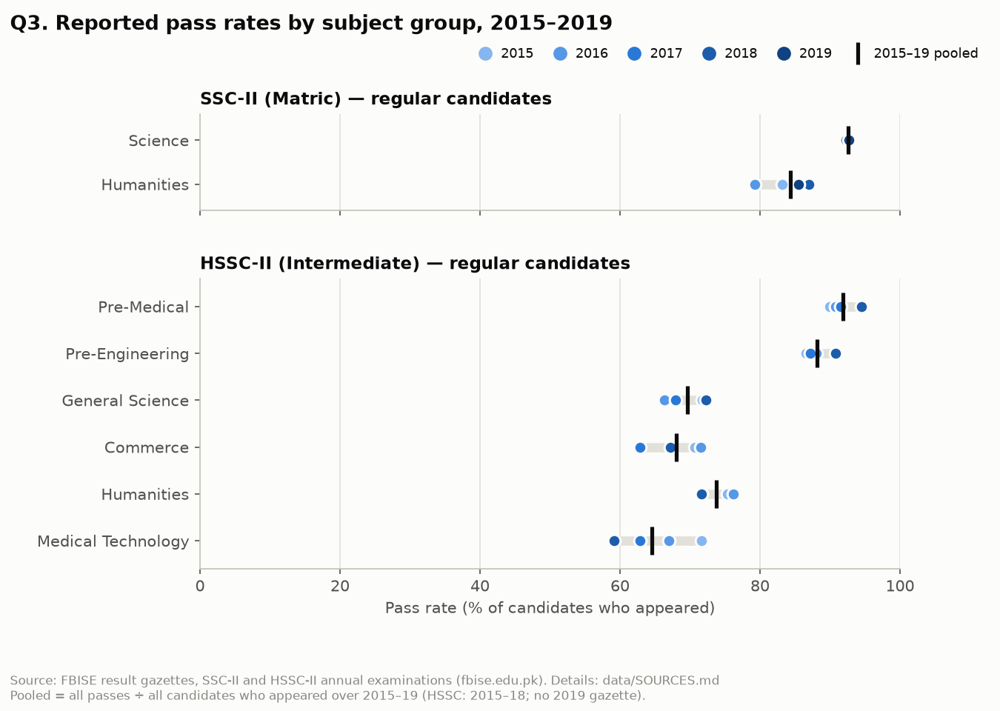
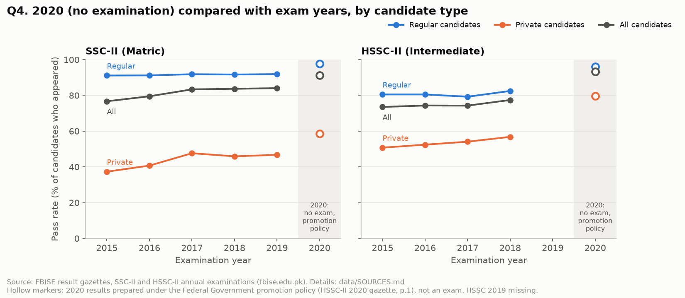

# Findings

**Scope of every finding:** one board (FBISE), final-year annual
examinations: SSC-II (Matric) and HSSC-II (Intermediate). Full breakdowns cover
2015–2019; HSSC-II 2019 is missing. Pass rate = passed ÷ appeared × 100.
Differences are in percentage points (pp). These are **descriptive** results
about reported figures. None of them establishes a cause.

Numbers below come from `data/processed/summaries/*.csv`, written by
`python -m scripts.make_figures` from `data/processed/results_tidy.csv`.
Sources: `data/SOURCES.md`. The questions were fixed in advance
(`DECISIONS.md`, ADR-002).

---

## 1. The overall SSC-II pass rate rose, but the regular-candidate rate barely changed

**Observed.**
- **SSC-II:** the all-candidate pass rate rose from 77.67% (2013) to 84.03%
  (2019), +6.36 pp; from 2015 to 2019 it rose +7.34 pp.
- **SSC-II regular candidates:** the rate stayed between 91.10% and 91.87%,
  +0.77 pp from 2015 to 2019.
- **SSC-II private candidates:** their share of those who appeared fell from
  26.80% (2015) to 17.38% (2019), and their own pass rate rose from 37.33% to
  46.75%.
- **HSSC-II:** the all-candidate rate rose from 72.30% (2013) to 77.41% (2018),
  +5.11 pp. The regular rate went 80.53% → 79.23% (2017) → 82.47% (2018),
  +1.94 pp over 2015–2018.

**Evidence.** `figures/q1_overall_trend.png`; tables `q1_overall_trend.csv`,
`q1_candidate_mix.csv`, `q4_candidate_type_trend.csv`. 2013–2014 come from
FBISE's *Result Statistics 2013–2017* (overall % only); 2015 onward from the
gazettes.

**Caveat.** The overall rate mixes two very different groups, so it can move
when their proportions change. The private share fell and the private rate
rose over the same period. Nothing here measures learning: a higher reported pass rate
can also reflect changes in papers or marking, which the gazettes do not
document.

---

## 2. Female candidates had higher reported pass rates in every comparable group, with gap sizes that depend strongly on the group

**Observed** (regular candidates; female minus male; range across exam years):

| Level | Group | Gap (pp) |
|---|---|---|
| SSC-II | Science | +4.15 to +5.54 |
| SSC-II | Humanities | +22.03 to +30.60 |
| HSSC-II | Pre-Medical | +1.90 to +4.51 |
| HSSC-II | Pre-Engineering | +3.21 to +4.77 |
| HSSC-II | General Science | +13.97 to +19.59 |
| HSSC-II | Commerce | +22.07 to +27.81 |
| HSSC-II | Humanities | +24.73 to +25.53 |

All 30 comparable group-year cells (SSC: 2 groups × 5 years; HSSC: 5 groups ×
4 years) show a positive gap. With all groups combined
the gap is +3.01 to +5.25 pp (SSC) and +9.54 to +10.72 pp (HSSC), which hides
the spread between groups.

**Evidence.** `figures/q2_gender_gap.png`; `q2_gender_gaps.csv`,
`q2_overall_gender_gap.csv`.

**Caveat.** This describes reported results only. The data say nothing about
*why* the gaps exist (e.g. who chooses which group, school type, tuition), so
no explanation is offered. HSSC Medical Technology is excluded (17–32 female
regular candidates per year, below the 100-candidate rule). Private candidates
are not part of this comparison.

---

## 3. Science-track groups had the highest reported pass rates

**Observed** (regular candidates, pooled over 2015–2019; HSSC 2015–2018):

| Level | Group | Pooled pass rate | Lowest–highest year |
|---|---|---|---|
| SSC-II | Science | 92.57% | 92.27–92.91% |
| SSC-II | Humanities | 84.37% | 79.24–86.98% |
| HSSC-II | Pre-Medical | 91.83% | 89.93–94.45% |
| HSSC-II | Pre-Engineering | 88.17% | 86.54–90.79% |
| HSSC-II | Humanities | 73.71% | 71.63–76.20% |
| HSSC-II | General Science | 69.59% | 66.38–72.31% |
| HSSC-II | Commerce | 68.05% | 62.88–71.58% |
| HSSC-II | Medical Technology | 64.59% | 59.16–71.67% |

In every exam year Pre-Medical ranked first and Pre-Engineering second among
HSSC groups, and SSC Science was above SSC Humanities. The order of the other
four HSSC groups changed from year to year.

**Evidence.** `figures/q3_group_pass_rates.png`; `q3_group_pass_rates.csv`.

**Caveat.** Groups sit different papers and attract different students, so a
lower rate does not mean a group is harder or worse taught. Medical Technology
is small (180–262 regular candidates a year), so its yearly rate is less stable.

---

## 4. Reported 2020 results (no exam) were above every exam year, and almost no one was recorded as failing

**Observed.** 2020 compared with the highest exam-year rate in 2015–2019
(HSSC 2015–2018):

| Level | Candidates | 2020 | Highest exam year | Difference |
|---|---|---|---|---|
| SSC-II | Regular | 97.67% | 91.87% | +5.80 pp |
| SSC-II | Private | 58.57% | 47.64% | +10.93 pp |
| SSC-II | All | 91.26% | 84.03% | +7.23 pp |
| HSSC-II | Regular | 95.97% | 82.47% | +13.51 pp |
| HSSC-II | Private | 79.53% | 56.80% | +22.73 pp |
| HSSC-II | All | 93.22% | 77.41% | +15.81 pp |

Candidates recorded as failing were 1.13% (SSC) and 0.34% (HSSC) of those who
appeared in 2020, against 15.91–23.25% (SSC) and 22.50–26.44% (HSSC) in
the exam years. In 2020, 8.74% (SSC) and 6.78% (HSSC) were listed as "result
later", against at most 0.47% in exam years. Among private candidates, 41.43%
(SSC) and 20.47% (HSSC) were "result later".

**Evidence.** `figures/q4_2020_vs_exam_years.png`; `q4_compare_2020.csv`; the
fail and result-later shares are computed in the notebook (Q4) from
`results_tidy.csv`. Policy statement: HSSC-II 2020 gazette, page 1.

**Caveat.** 2020 results were produced under a promotion policy, not by an
examination (gazette, p.1), so they are a different kind of number from the exam
years. This comparison shows only how different the reported figures were;
it says nothing about what students learned. Private-candidate 2020 rates are
not final, because many results were still "later".

---

## Questions this data could not answer

- **Differences between boards:** only FBISE data was verified. The gazettes'
  regional tables (Punjab, Sindh, …) describe FBISE-affiliated institutions,
  not the provincial boards (ADR-002).
- **Average marks:** not published.
- **Anything after 2020:** no official FBISE copies of later gazettes were found
  on fbise.edu.pk (ADR-001).
